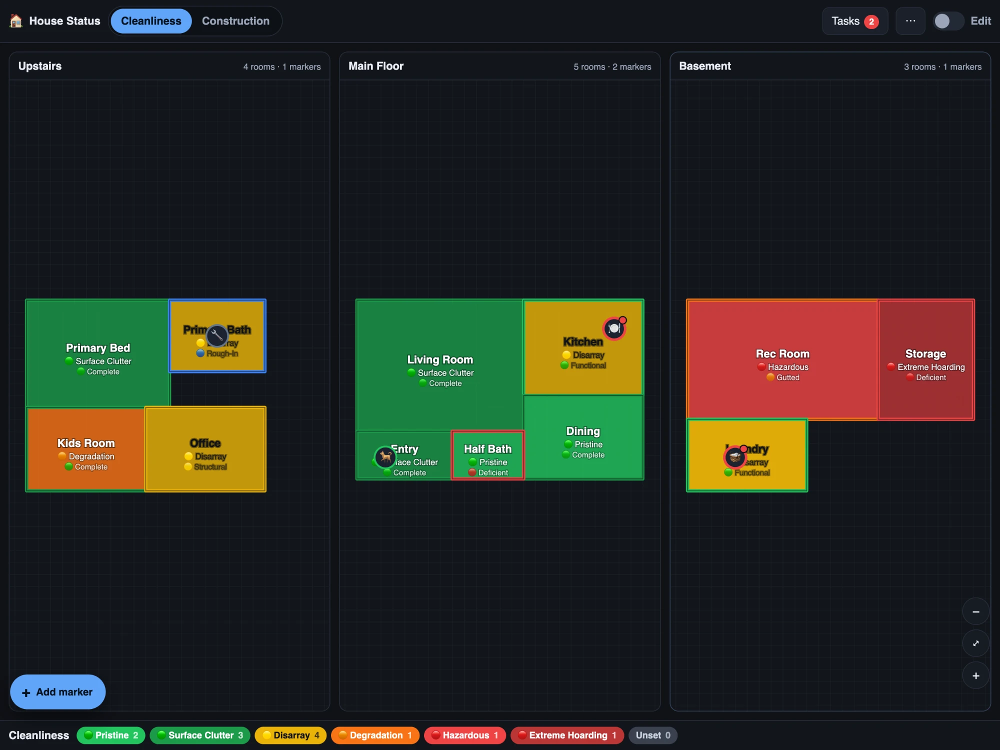

# House Status

A one-page floorplan dashboard for a household: draw (or upload) your floorplan,
outline each room, and colour every room by two independent status scales —
how clean it is, and how far along a renovation is. Add markers for appliances,
chores and pets that need doing on a schedule.

Everything runs in the browser. State and uploaded floorplan images live in
IndexedDB on the device; there is no account, no server, and no network call.



## Running it

The toolchain is pinned with [mise](https://mise.jdx.dev), which installs the
right Node and defines every command:

```bash
mise run setup && mise run dev
```

Without mise, install Node 24 yourself and use the npm scripts, which the mise
tasks delegate to: `npm install && npm run dev`.

Build a static bundle with `mise run build` (or `npm run build`) — the `dist/`
folder is plain files and can be served from anywhere. Asset paths are relative,
so serving it from a subpath (`/house/`) works without a rebuild. `mise run
preview` serves that build on your LAN if you just want to try it on a phone.

`mise run check` is the gate: lint, typecheck, and tests. It runs on every
commit through `.githooks/pre-commit` and in CI.

## Deploying

There is no backend, so "deploying" means putting the contents of `dist/`
behind any web server. Pick whichever of these matches your setup — the
Proxmox recipe is written out in full.

**Before you deploy anything, read [Serving over HTTPS](#serving-over-https)
below.** Over plain `http://` on a LAN address the app still works, but it
cannot be installed to a home screen and will not work offline.

### Proxmox VE — nginx in an LXC (lightest, recommended)

A 512 MB unprivileged container serving static files. No Docker, nothing to
keep patched but nginx itself.

On your workstation, build and ship the bundle to the Proxmox host:

```bash
mise run build
tar -czf house-status.tgz -C dist .
scp house-status.tgz deploy/proxmox-lxc.sh deploy/nginx-site.conf root@pve:/tmp/
```

Then on the Proxmox host, as root:

```bash
cd /tmp && ./proxmox-lxc.sh 120 /tmp/house-status.tgz
```

That creates container `120` from the current Debian 12 template, installs
nginx, unpacks the build to `/var/www/house-status`, installs the site config,
and prints the URL. Override the defaults with environment variables if your
host uses different names:

```bash
STORAGE=local-zfs BRIDGE=vmbr1 IPCONFIG=192.168.1.50/24 GATEWAY=192.168.1.1 \
  ./proxmox-lxc.sh 120 /tmp/house-status.tgz
```

To ship a new build later, repeat the same two commands — the script detects
the existing container and just replaces the files.

### Proxmox VE — creating the LXC through the web UI

The same thing, clicked rather than scripted. Nothing here assumes you have
used LXC before. Field names are from Proxmox VE 8/9; older releases differ
only slightly.

#### 1. Download a container template

1. In the left tree, expand your node and click the **local** storage (or
   whichever storage has *Container templates* in its content types).
2. Open **CT Templates**, click **Templates**.
3. Search for `debian`, pick the newest **debian-13-standard** (or
   **debian-12-standard**), click **Download**. Wait for the task to finish.

#### 2. Create the container

Click **Create CT**, top right. The wizard has one tab per step:

| Tab | Field | Value |
| --- | --- | --- |
| **General** | Node | your node |
| | CT ID | `120` (any free number) |
| | Hostname | `house-status` — see [naming](#3-give-it-a-name-you-can-type) below |
| | Unprivileged container | ✅ leave ticked |
| | Nested | leave unticked (only Docker needs it) |
| | Password | set one; this is the container's `root` password |
| | SSH public key | optional, but paste yours if you want `ssh root@…` |
| **Template** | Storage | `local` |
| | Template | the Debian template you just downloaded |
| **Disks** | Disk size (GiB) | `2` — the app is under a megabyte |
| **CPU** | Cores | `1` |
| **Memory** | Memory (MiB) | `512` |
| | Swap (MiB) | `256` |
| **Network** | Name | `eth0` |
| | Bridge | `vmbr0` (whatever your LAN bridge is) |
| | IPv4 | **Static**, e.g. `192.168.1.50/24`, Gateway `192.168.1.1` |
| **DNS** | everything | leave blank to inherit the host's settings |
| **Confirm** | Start after created | ✅ tick it |

A static IP is worth the extra thirty seconds: it is what you will point a DNS
record or a bookmark at, and it survives DHCP lease churn. If you'd rather use
DHCP, reserve the address in your router instead.

After it boots, select the container → **Options** → **Start at boot** →
**Edit** → ✅. The wizard has no field for this, and without it the dashboard
disappears after a host reboot.

#### 3. Give it a name you can type

The **Hostname** field names the container internally — it does *not* make
`house-status` resolve anywhere on your network, and HTTPS needs a name that
resolves. Pick one:

- **Your router or local DNS** (Pi-hole, AdGuard Home, Unbound, OPNsense):
  add an A record for `house.yourdomain.com` → the container's static IP. Best
  option, and the only one that works with a real certificate.
- **mDNS**, no DNS server needed — inside the container:
  `apt-get install -y avahi-daemon`, and it answers to `house-status.local`
  from Apple devices, most Linux, and Windows 10+.
- **Nothing at all** — use the IP. Fine over HTTP; for HTTPS you'll need
  Caddy's local CA (option 2 below), which will happily certify a bare IP.

#### 4. Install a web server and publish the build

Open the container's **Console** in the Proxmox UI and log in as `root`.

For plain HTTP with nginx:

```bash
apt-get update && apt-get install -y nginx
mkdir -p /var/www/house-status
```

For automatic HTTPS with Caddy — it serves the files *and* manages
certificates, so you do not need nginx at all:

```bash
apt-get update && apt-get install -y debian-keyring debian-archive-keyring apt-transport-https curl
curl -1sLf https://dl.cloudsmith.io/public/caddy/stable/gpg.key \
  | gpg --dearmor -o /usr/share/keyrings/caddy-stable-archive-keyring.gpg
curl -1sLf https://dl.cloudsmith.io/public/caddy/stable/debian.deb.txt \
  | tee /etc/apt/sources.list.d/caddy-stable.list
apt-get update && apt-get install -y caddy
mkdir -p /var/www/house-status
```

Then, from your workstation, build and push the files. `pct push` copies into
the container from the host, so the container needs no SSH server of its own:

```bash
mise run build
tar -czf house-status.tgz -C dist .
scp house-status.tgz deploy/nginx-site.conf deploy/Caddyfile root@pve:/tmp/
ssh root@pve 'pct push 120 /tmp/house-status.tgz /tmp/house-status.tgz'
```

Back in the container console, unpack and wire up the server:

```bash
tar -xzf /tmp/house-status.tgz -C /var/www/house-status
chown -R www-data:www-data /var/www/house-status   # or caddy:caddy for Caddy
```

**nginx:**

```bash
# push the config in too: ssh root@pve 'pct push 120 /tmp/nginx-site.conf /etc/nginx/sites-available/house-status'
ln -sf /etc/nginx/sites-available/house-status /etc/nginx/sites-enabled/
rm -f /etc/nginx/sites-enabled/default
nginx -t && systemctl reload nginx
```

**Caddy:** edit `/etc/caddy/Caddyfile` — start from `deploy/Caddyfile`, put your
own hostname on the first line, and uncomment one of the three `tls` blocks it
documents. Then:

```bash
caddy validate --config /etc/caddy/Caddyfile && systemctl reload caddy
```

Visit the address and you should get the sample house.

#### 5. Automatic HTTPS, in one of three ways

Certificates matter here: without one, the browser will not register the
service worker or offer to install the app (see
[Serving over HTTPS](#serving-over-https)). Caddy handles all three of these on
its own, renewals included — there is no cron job to set up.

**A real certificate for a name that never leaves your LAN.** You own a domain,
you point `house.yourdomain.com` at the container's private IP in your local
DNS, and Caddy proves ownership through your DNS provider's API rather than
over the internet. Nothing is exposed publicly. The stock Caddy binary ships
no DNS modules, so add yours first:

```bash
caddy add-package github.com/caddy-dns/cloudflare
systemctl edit caddy     # [Service] / Environment=CF_API_TOKEN=your-token
systemctl restart caddy
```

with this in the Caddyfile:

```caddyfile
tls {
	dns cloudflare {env.CF_API_TOKEN}
}
```

Providers other than Cloudflare are at <https://github.com/caddy-dns>. The API
token needs only DNS-edit rights on that one zone.

**No domain? Caddy's own certificate authority.** One line:

```caddyfile
tls internal
```

Caddy issues itself a certificate for whatever name — or bare IP — you used,
immediately and offline. The catch is that each phone and laptop has to trust
Caddy's root once. Copy it out of the container and install it on each device:

```bash
pct pull 120 /var/lib/caddy/.local/share/caddy/pki/authorities/local/root.crt /tmp/caddy-root.crt
```

**Tailscale, if the family is ever away from home.** `tailscale serve --bg 80`
puts the app on your tailnet under a `*.ts.net` name with a real, auto-renewed
certificate, reachable from anywhere without opening a single port. In an
**unprivileged LXC** Tailscale needs the TUN device, which means adding two
lines to `/etc/pve/lxc/120.conf` on the Proxmox host (container stopped):

```
lxc.cgroup2.devices.allow: c 10:200 rwm
lxc.mount.entry: /dev/net dev/net none bind,create=dir
```

#### 6. Later, to ship a new build

```bash
mise run build
tar -czf house-status.tgz -C dist .
scp house-status.tgz root@pve:/tmp/
ssh root@pve 'pct push 120 /tmp/house-status.tgz /tmp/house-status.tgz \
  && pct exec 120 -- tar -xzf /tmp/house-status.tgz -C /var/www/house-status'
```

No restart needed — they're static files, and the cache headers make sure
browsers pick them up.

### Proxmox VE — Docker in an LXC or VM

If you already run a Docker host on Proxmox, use the image instead. In an
**unprivileged LXC**, Docker needs nesting and keyctl turned on first —
run this on the Proxmox host, with the container stopped:

```bash
pct set 121 --features nesting=1,keyctl=1
```

Then inside the container (or VM), with the repo checked out:

```bash
docker compose up -d --build
```

### Docker, anywhere

```bash
docker compose up -d --build      # http://localhost:8088
```

or without compose:

```bash
docker build -t house-status .
docker run -d --name house-status --restart unless-stopped -p 8088:80 house-status
```

The image is a multi-stage build: Node compiles the bundle, and the shipped
image is `nginx:alpine` plus the ~190 kB of static files — about 92 MB total,
with the toolchain left behind in the build stage. It holds no state, so it can
be killed, rebuilt, and replaced freely; the data lives in each browser. Update
with `docker compose up -d --build` again.

### Home Assistant, without an add-on

If you already run Home Assistant, its `www` folder is a static host:

```bash
mise run build
scp -r dist/* root@homeassistant:/config/www/house-status/
```

It is then served at `http://<ha-host>:8123/local/house-status/index.html`, and
inherits whatever remote access and TLS you already have set up for HA. Add it
as a dashboard with a Webpage card pointing at that URL.

### Anything else

`dist/` is just files. Copy it into an existing nginx/Caddy/Apache root, a
Synology or TrueNAS share, an S3 bucket, GitHub Pages, Netlify, or a Tailscale
node. For a five-second local trial: `cd dist && python3 -m http.server 8000`.

### Serving over HTTPS

Installing to a home screen and working offline both require a *secure
context*: `https://`, or `http://localhost`. On a bare LAN address like
`http://192.168.1.50/` the app loads and saves data normally, but the browser
will refuse to register the service worker or offer "Add to Home Screen".

To get the full PWA behaviour, put it behind something that terminates TLS:

- A reverse proxy you already run (Caddy gets a LAN cert with almost no
  config; Nginx Proxy Manager and Traefik work too), with a real hostname
  under a domain you own and a DNS-01 Let's Encrypt certificate.
- Tailscale, whose MagicDNS names come with valid certificates — handy for
  family members' phones off the home network.
- A self-signed cert, if you don't mind trusting it on each device.

### After deploying

- Each browser keeps its own data, keyed to the exact origin. Moving the app
  from `http://192.168.1.50/` to `https://house.example.com/` starts you at an
  empty house — use **⋯ → Export JSON** first, then Import on the new URL.
- Redeploys pick up automatically. The site config marks `index.html`,
  `sw.js`, and the manifest `no-cache` while hashed assets cache for a year, so
  an installed PWA sees the new build on its next load rather than serving a
  stale one forever.
- To hand the plan to another family member's phone, export the JSON and send
  them the file — or just have them open the same URL and set it up as their
  own copy.

## Using it

**Normal mode** (the default) is for the daily loop:

- Tap a room to open it — set its status on each scale, add notes and
  instructions, see when it last changed.
- Tap a marker to update it, adjust its repeat interval, or mark it done.
- **+ Add marker** places a new marker without leaving normal mode: press it,
  then tap anywhere on any level.
- The **Cleanliness / Construction** toggle picks which scale fills the rooms;
  the other scale is drawn as the room's border colour, so both are visible at
  once. Every room also prints both labels.
- **Tasks** lists every marker, overdue first, with a one-tap done button.

**Edit mode** (the switch, top right) is for building the plan:

- ▭ drag a rectangle, ⬠ click polygon corners and click the first corner (or
  press Enter) to close, Esc to cancel.
- ➚ select: drag a room to move it, drag its corner handles to reshape, drag a
  marker to reposition it. Delete removes the selection.
- Click a level's empty background to open its settings: rename, reorder, and
  upload a floorplan image to trace over (with scale, offset and opacity).
- **+ Level** adds a floor. All levels stay visible at once and share one
  pan/zoom, so they line up with each other.

## Status scales

The two default scales are the ones from the spec. Edit them under **⋯ → Status
scales**, one level per line:

```
🟡 Disarray: Overflowing drawers, doom piles, and partially blocked paths.
```

The colour comes from the icon (🟢 🟡 🟠 🔴 🔵 🟣 🟤 ⚪ ⚫). If a scale uses the
same icon twice, the later one is drawn a shade deeper so the steps stay
distinguishable. Put a hex code like `#3b82f6` anywhere on the line to set the
colour by hand. Add or remove whole scales too — rooms carry a status per scale,
and the first scale is the default fill.

A level's id is derived from its label, so renaming `Disarray` to `Chaos`
detaches rooms that were set to it; changing only the description or icon is
safe.

## Data

- Stored in IndexedDB under the origin serving the app. Different origins
  (`localhost:5273` vs. `house.lan`) are different databases.
- **⋯ → Export JSON** writes the whole house — levels, rooms, markers, scales,
  and the embedded floorplan images — to one file. Import replaces the current
  state, which is also how you move a plan to another device or share it with
  the family.
- **Start over** erases the local database.

## Layout

```
src/
  App.tsx                  layout, modes, keyboard, export/import
  state.ts                 reducer, sample house, due-date maths
  scales.ts                scale text parser and colour derivation
  storage.ts               IndexedDB, file reads, JSON download
  geometry.ts              world coordinates, polygons, hit testing
  components/
    FloorPanel.tsx         one level: SVG canvas, drawing and pointer handling
    Inspector.tsx          room / marker / level side panel
    ScaleSettings.tsx      the scale editor
deploy/
  proxmox-lxc.sh           creates/updates an nginx LXC on a Proxmox host
  nginx-site.conf          site config for a plain nginx host
docker/
  nginx.conf               the same config, for inside the image
Dockerfile                 multi-stage build -> nginx:alpine
docker-compose.yml         one-command run on :8088
```

All levels render into a shared world coordinate space (1000 × 750 units) and
share one view (`{cx, cy, zoom}`), which is what makes them pan and zoom
together.

## Not built yet

- Sync between devices — the export/import round trip is the current answer.
  A Home Assistant add-on that persists the same JSON blob server-side is the
  intended next step; the state shape is already a single serialisable object.
- Undo/redo.
- Rotating or skewing an uploaded floorplan image (scale and offset only).
